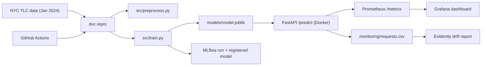
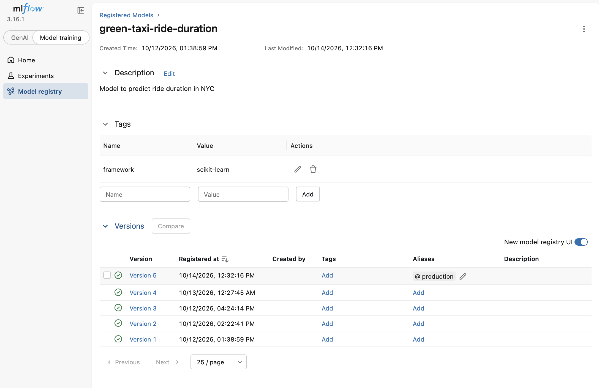

# MLOps Project
Avi Putri Pertiwi

A small but complete MLOps workflow around a linear regression model that predicts
NYC green taxi trip duration: reusable training code, DVC-versioned data, MLflow
tracking, automated retraining with GitHub Actions, a FastAPI service, and monitoring
with Prometheus, Grafana and Evidently.

> **Scope:** historical replay. `trip_distance` is the taximeter distance of a
> *completed* trip, not an estimate available at pickup. Predictions are therefore
> not usable for real-time ETA before a trip starts.

## Architecture



## Project Structure

| Path | Purpose |
|---|---|
| `src/preprocess.py` | Download, clean and feature-prep the taxi data |
| `src/train.py` | Train, evaluate, save, and log/register the model in MLflow |
| `src/api.py` | FastAPI service: `/predict`, `/health`, `/metrics` |
| `src/send_requests.py` | Replays real trips against the API |
| `src/generate_report.py` | Evidently drift report: training data vs. API requests |
| `src/check_drift.py` | Drift on the shifted batch (2/4 columns) triggered retraining → model v4 |
| `src/check_api.py` | Checks health, predict, negative distance, zone 999, missing field, metrics, logged row |
| `dvc.yaml` / `dvc.lock` | Reproducible pipeline and data/model hashes |
| `.github/workflows/train.yaml` | Automated training in CI |
| `Dockerfile`, `docker-compose.yaml` | API + Prometheus + Grafana stack |
| `monitoring/` | Prometheus config, Grafana provisioning and dashboard |

## Model

- **Data:** NYC green taxi trips, January 2024 (~49545 rows after cleaning)
- **Features:** `PULocationID`, `DOLocationID` (categorical), `trip_distance`
- **Target:** trip duration in minutes (filtered to 1–60 min, 0.1–100 miles)
- **Model:** `DictVectorizer` + `LinearRegression`
- **Result:** RMSE ≈ **5.068 min** on a 20% hold-out (same as the notebook baseline)

## How to Run

All commands run from the repository root.

### 1. Setup
```bash
uv sync
cp .env.example .env
```

### 2. Train (DVC + MLflow)
```bash
uv run dvc repro
uv run dvc metrics show
uv run mlflow ui --backend-store-uri sqlite:///mlflow.db --port 5001
```

### 3. Start the API and monitoring stack
```bash
docker compose up --build -d
```

| Service | URL |
|---|---|
| API docs | http://127.0.0.1:8000/docs |
| Prometheus | http://127.0.0.1:9090/targets |
| Grafana (admin/admin) | http://127.0.0.1:3000 |
| MLflow | http://127.0.0.1:5001 |

### 4. Example prediction
```bash
curl -X POST http://127.0.0.1:8000/predict \
  -H "Content-Type: application/json" \
  -d '{"PULocationID": 74, "DOLocationID": 75, "trip_distance": 1.8}'
```
Response:
```json
{"predicted_duration_min": 10.55, "model_version": "5"}
```

### 5. Send traffic and generate the drift report
```bash
uv run python -m src.send_requests
uv run python -m src.generate_report
open monitoring/reports/data_drift_report.html
```

### 6. Trigger retraining when meaningful data drift detected
```bash
uv run python -m src.check_drift --current monitoring/requests_baseline.csv
uv run python -m src.check_drift --current monitoring/requests_shifted.csv
```
Retrain
```bash
uv run python -m src.check_drift --current monitoring/requests_shifted.csv --retrain
docker compose restart api
```

### 7. Add a small smoke test for the API or training entry point

```bash
uv run python -m src.check_api
```

Results:
```
API checks passed: health, prediction (10.26 min), 3x HTTP 422, /metrics, request logging.
```

Then add, commit, and push changes to GH.

### 8. Stop
```bash
docker compose down
```

## CI/CD

`.github/workflows/train.yaml` runs on pushes and PRs that touch training code or
data definitions (and manually via *Run workflow*). It installs locked dependencies
(`uv sync --locked`), runs `dvc repro` (download → train → MLflow logging) and uploads
the MLflow store, model and metrics as a build artifact.

## Results

### MLflow


*Model registry: five versions of `green-taxi-ride-duration`, with the `@production` alias on the latest. A new version is registered on every training run, including the drift-triggered retrain.*

### GitHub Actions


### Prometheus & Grafana


### Evidently: baseline vs. shifted batch
| Baseline (Feb 2024) | Shifted (distance × 3) |
|---|---|
|  |  |

## Limitations & Next Steps

- `trip_distance` is only known after the trip (historical replay).
- The request log has no true durations, so live accuracy can't be measured.
- MLflow in CI uses a temporary SQLite store; a hosted tracking server would persist runs.
- Possible extensions: retrain automatically on drift, API smoke tests in CI,
  `params.yaml` for the training month.
