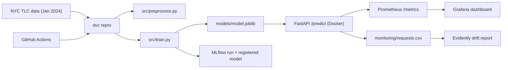
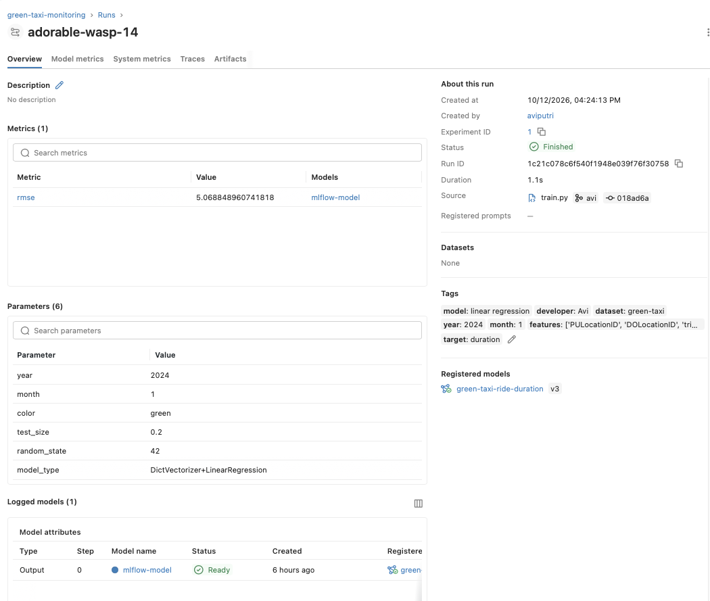
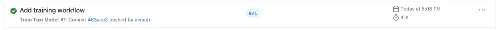
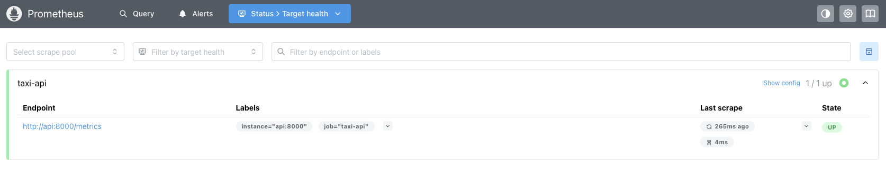
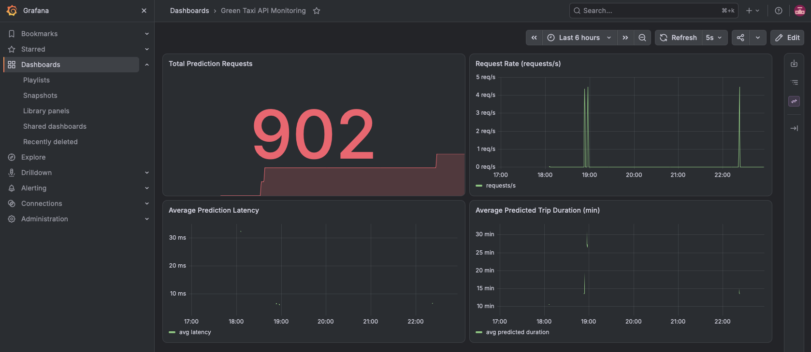
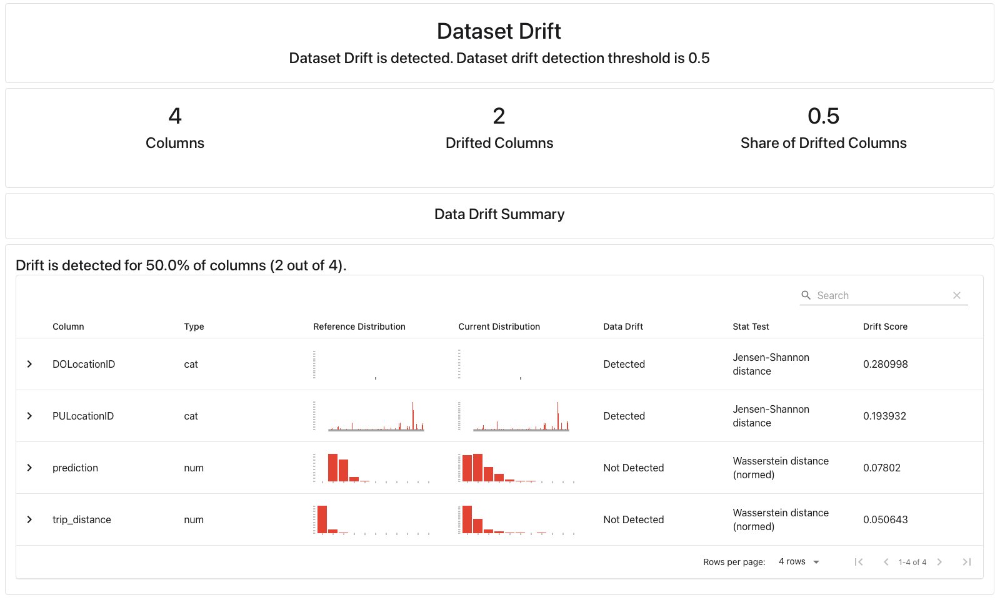
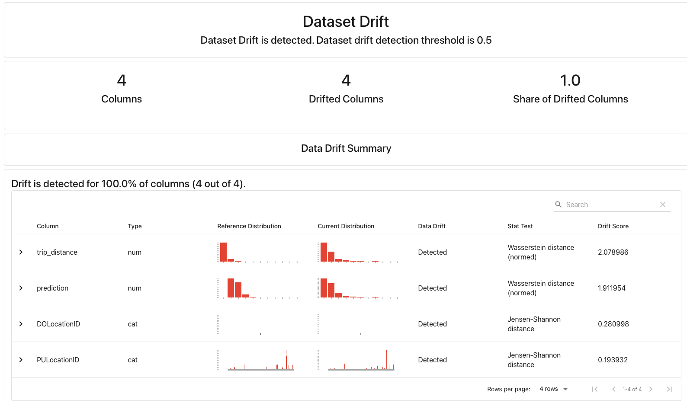
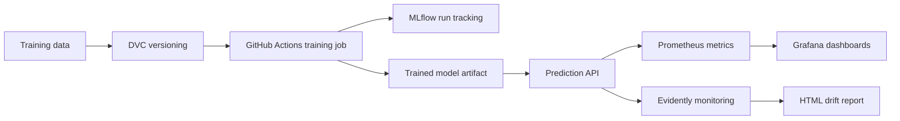

# MLOps Project
Avi Putri Pertiwi

A small but complete MLOps workflow around a linear regression model that predicts
NYC green taxi trip duration: reusable training code, DVC-versioned data, MLflow
tracking, automated retraining with GitHub Actions, a FastAPI service, and monitoring
with Prometheus, Grafana and Evidently.

> **Scope:** historical replay. `trip_distance` is the taximeter distance of a
> *completed* trip, not an estimate available at pickup. Predictions are therefore
> not usable for real-time ETA before a trip starts.

## Architecture



## Project Structure

| Path | Purpose |
|---|---|
| `src/preprocess.py` | Download, clean and feature-prep the taxi data |
| `src/train.py` | Train, evaluate, save, and log/register the model in MLflow |
| `src/api.py` | FastAPI service: `/predict`, `/health`, `/metrics` |
| `src/send_requests.py` | Replays real trips against the API |
| `src/generate_report.py` | Evidently drift report: training data vs. API requests |
| `src/check_drift.py` | Drift on the shifted batch (2/4 columns) triggered retraining → model v4 |
| `src/check_api.py` | Checks health, predict, negative distance, zone 999, missing field, metrics, logged row |
| `dvc.yaml` / `dvc.lock` | Reproducible pipeline and data/model hashes |
| `.github/workflows/train.yaml` | Automated training in CI |
| `Dockerfile`, `docker-compose.yaml` | API + Prometheus + Grafana stack |
| `monitoring/` | Prometheus config, Grafana provisioning and dashboard |

## Model

- **Data:** NYC green taxi trips, January 2024 (~<N> rows after cleaning)
- **Features:** `PULocationID`, `DOLocationID` (categorical), `trip_distance`
- **Target:** trip duration in minutes (filtered to 1–60 min, 0.1–100 miles)
- **Model:** `DictVectorizer` + `LinearRegression`
- **Result:** RMSE ≈ **<5.068> min** on a 20% hold-out (same as the notebook baseline)

## How to Run

All commands run from the repository root.

### 1. Setup
```bash
uv sync
cp .env.example .env
```

### 2. Train (DVC + MLflow)
```bash
uv run dvc repro
uv run dvc metrics show
uv run mlflow ui --backend-store-uri sqlite:///mlflow.db --port 5001
```

### 3. Start the API and monitoring stack
```bash
docker compose up --build -d
```

| Service | URL |
|---|---|
| API docs | http://127.0.0.1:8000/docs |
| Prometheus | http://127.0.0.1:9090/targets |
| Grafana (admin/admin) | http://127.0.0.1:3000 |

### 4. Example prediction
```bash
curl -X POST http://127.0.0.1:8000/predict \
  -H "Content-Type: application/json" \
  -d '{"PULocationID": 74, "DOLocationID": 75, "trip_distance": 1.8}'
```
Response:
```json
{"predicted_duration_min": 10.55, "model_version": "3"}
```

### 5. Send traffic and generate the drift report
```bash
uv run python -m src.send_requests
uv run python -m src.generate_report
open monitoring/reports/data_drift_report.html
```

### 6. Trigger retraining when meaningful data drift detected
```bash
uv run python -m src.check_drift --current monitoring/requests_baseline.csv
uv run python -m src.check_drift --current monitoring/requests_shifted.csv
```
Retrain
```bash
uv run python -m src.check_drift --current monitoring/requests_shifted.csv --retrain
docker compose restart api
```

### 7. Add a small smoke test for the API or training entry point

```bash
uv run python -m src.check_api
```

Results:
```
API checks passed: health, prediction (10.26 min), 3x HTTP 422, /metrics, request logging.
```

Then add, commit, and push changes to GH.

### 8. Stop
```bash
docker compose down
```

## CI/CD

`.github/workflows/train.yaml` runs on pushes and PRs that touch training code or
data definitions (and manually via *Run workflow*). It installs locked dependencies
(`uv sync --locked`), runs `dvc repro` (download → train → MLflow logging) and uploads
the MLflow store, model and metrics as a build artifact.

## Results

### MLflow


### GitHub Actions


### Prometheus & Grafana



### Evidently: baseline vs. shifted batch
| Baseline (Feb 2024) | Shifted (distance × 3) |
|---|---|
|  |  |

## Limitations & Next Steps

- `trip_distance` is only known after the trip (historical replay).
- The request log has no true durations, so live accuracy can't be measured.
- MLflow in CI uses a temporary SQLite store; a hosted tracking server would persist runs.
- Possible extensions: retrain automatically on drift, API smoke tests in CI,
  `params.yaml` for the training month.


---------------
Original ReadMe below
---------------

# MLOps Project

Use this repository as a **template** for your MLOps project. You will turn a notebook-based taxi trip-duration model into a reproducible MLOps workflow. You version training data with DVC, track runs with MLflow, automate training with GitHub Actions, serve predictions through an API, and monitor the system with Evidently, Prometheus, and Grafana.

The training notebook is included so you can start from the model used in the monitoring lesson. Keep your project small and use pull requests in your own repository to track your work, even when working alone.

## Learning Objectives

By the end of this repository, you should be able to:

- Convert notebook experimentation into reusable training code.
- Automate retraining with GitHub Actions.
- Version training data and model artifacts with DVC and MLflow.
- Serve a trained model through an API.
- Monitor model behavior, data quality and operational metrics with an observability stack.

## Learning Path

| File / Folder | Description |
|---|---|
| [**Project Description**](project-description.md) | Assignment brief, deliverables, and suggested milestones. |
| [**01 - Train an ML Model**](01-train-ml-model.ipynb) | Supplied taxi training notebook to refactor into reusable Python code. |

### Additional Folders and Files

| File / Folder | Description |
|---|---|
| [**assets**](assets/) | Visual aids referenced in the repository. |
| [**solution/README.md**](solution/README.md) | Optional reference workflow using Iris, DVC, MLflow, FastAPI, and monitoring. |
| [**solution/src**](solution/src/) | Data preparation, training, API, and report scripts for the reference solution. |
| [**solution/monitoring**](solution/monitoring/) | Prometheus configuration and provisioned Grafana dashboard. |
| [**solution/docker-compose.yaml**](solution/docker-compose.yaml) | The three-service reference stack. |
| [**.github/workflows/reference-solution.yaml**](.github/workflows/reference-solution.yaml) | Existing workflow that validates the reference pipeline and API. |
| [**pyproject.toml**](pyproject.toml) | Project configuration and dependencies. |
| [**uv.lock**](uv.lock) | Dependency lock file shared by the notebook and reference solution. |

The starter notebook comes from [mle-monitoring-in-ml](https://github.com/neuefische/mle-monitoring-in-ml/blob/2a805a98f7d6cf2266b291c0984c98f93bc6d9d3/01-train-ml-model.ipynb). The Iris solution illustrates the operational workflow; it is not a replacement for refactoring your taxi model.

## Project Flow



## Local Data Services

The notebook uses a local MLflow SQLite tracking store. The reference solution provides an API, Prometheus, and Grafana through Docker Compose:

| Service | Local URL |
|---|---|
| Notebook MLflow UI (when started) | <http://127.0.0.1:5000> |
| Reference prediction API / Swagger UI | <http://127.0.0.1:8000/docs> |
| Prometheus targets | <http://127.0.0.1:9090/targets> |
| Grafana | <http://127.0.0.1:3000> |

Grafana's initial local login is `admin` / `admin`. These services and default credentials are for local learning, not public deployment. Follow [solution/README.md](solution/README.md) to start the reference stack.

## Prerequisites

- **Docker Desktop**: required for the reference monitoring stack and for validating a containerized project. Follow the [installation instructions](https://docs.docker.com/get-docker/) if you do not have it yet. Make sure it is **installed and running** before starting the containers.

## Setup

> [!NOTE]
> Throughout these steps, text in angle brackets like `<repo-name>` is a **placeholder**. Replace it, including the `< >` brackets, with your own value. For example, `cd <repo-name>` becomes `cd mle-mlops-project`.

### 1. Use This Repository as a Template

Click **Use this template** on GitHub.

When creating the repository:

- Set yourself as the **Owner**
- Choose a repository name
- Disable **Include all branches**
- Click **Create repository**

> [!IMPORTANT]
> If you are working in pairs or groups, only **one person** should complete this step.

---

### 2. Add Collaborators (Pairs/Groups Only)

If working with teammates:

1. Open the repository on GitHub
2. Go to **Settings → Collaborators**
3. Add your teammates as collaborators
4. Share the repository link with your team

Teammates should accept the invitation before continuing.

---

### 3. Clone Your Copy

Copy the SSH URL from the **Code** button on GitHub, then run:

```bash
git clone <copied-ssh-url>
```

The copied SSH URL will look like `git@github.com:<your-username>/<repo-name>.git`.

---

### 4. Move into the Project Folder and Install Dependencies

This project uses Python 3.13. The command below installs all dependencies and creates a virtual environment in `.venv/`.

```bash
cd <repo-name>
uv sync
```

The notebook and `solution/` share this environment. Do not create another environment inside `solution/`.

---

### 5. Create the Environment File

Copy the template once:

```bash
cp .env.example .env
```

Keep the default local tracking URI for the taxi notebook. The Iris reference solution manages its own tracking store in `solution/mlflow.db`.

> [!CAUTION]
> Never commit `.env`. It is git-ignored because environment files often hold secrets. Only `.env.example`, with placeholder or default values, belongs in the repository.

---

### 6. Open the Repository in VS Code

> [!NOTE]
> Make sure you open VS Code from the project root so it automatically detects the environment created by `uv sync`.

Launch VS Code in the project root folder:

```bash
code .
```

Then open [01-train-ml-model.ipynb](01-train-ml-model.ipynb) and select the Python environment created by `uv sync` as the kernel.

Run the notebook from the project root. Python commands use `uv run`, so the environment is selected automatically; no manual activation is needed.

## References & Further Reading

- [DVC Pipelines](https://dvc.org/doc/user-guide/pipelines): Version training inputs and reproduce dependent stages.
- [MLflow Model Registry Workflows](https://mlflow.org/docs/latest/ml/model-registry/workflow/): Register models, manage versions, and assign aliases.
- [Evidently Reports](https://docs.evidentlyai.com/docs/library/report): Compare reference and current datasets and export reports.
- [Prometheus Overview](https://prometheus.io/docs/introduction/overview/): Understand metric scraping, time series, and PromQL queries.
- [Grafana Provisioning](https://grafana.com/docs/grafana/latest/administration/provisioning/): Load data sources and dashboards from version-controlled files.
